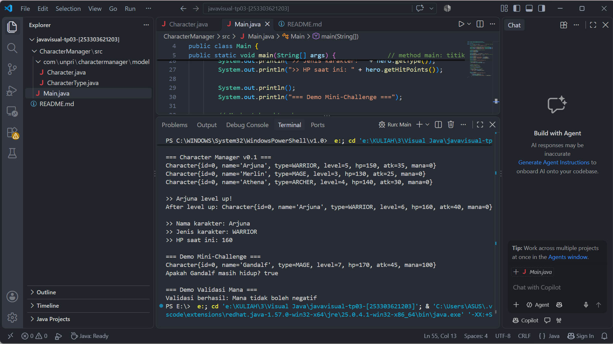

# Character Manager — TP3 (Java Visual SIH-6406)

## Deskripsi
Character Manager merupakan project Java yang dibuat untuk memenuhi tugas TP3 pada mata kuliah Java Visual SIH-6406. Project ini mengimplementasikan class Character dan enum CharacterType dengan menerapkan konsep encapsulation, constructor, getter, setter, dan toString().
Project ini juga dikembangkan dengan fitur mana, validasi nilai mana agar tidak negatif, serta method isAlive() untuk memeriksa status hidup karakter berdasarkan hit points (HP).

## Screenshot Output
Berikut merupakan hasil eksekusi program Character Manager melalui terminal VS Code, termasuk demo level up, pengaturan mana, dan pemeriksaan status hidup karakter.


## Struktur Folder Project
```text
javavisual-tp03-[253303621203]/
├── CharacterManager/
│   └── src/
│       ├── Main.java
│       └── com/
│           └── unpri/
│               └── charactermanager/
│                   └── model/
│                       ├── Character.java
│                       └── CharacterType.java
├── screenshots/
│   └── output.png
└── README.md
```

## Identitas Mahasiswa
- Nama Lengkap: Rachel Clarita Oktaviana Br Silaban
- NIM: 253303621203
- Kelas: Sistem Informasi 3 Pagi A
- Google Docs: [https://1drv.ms/w/c/8cf06abcf94f4402/IQBVsC23ZuFkQ7QJIkGGcEdqAcBMMpEbR0kI634psBQ_ioQ?e=5bharh]