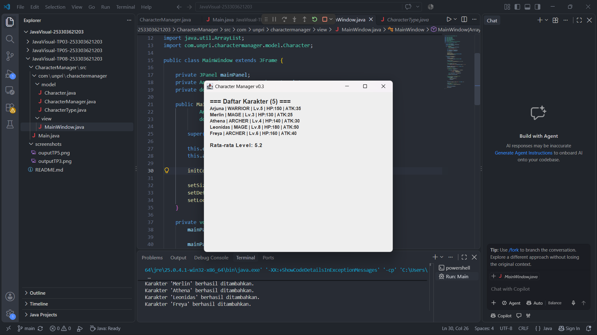

# GUI dan MVC — TP8

## Screenshot Output


## Aliran Data dan MVC

Main.java membuat objek CharacterManager dan menambahkan data karakter. CharacterManager berperan sebagai Model yang mengelola data karakter serta menghitung rata-rata level menggunakan method getAverageLevel(). Selanjutnya, Main.java mengirimkan daftar karakter dan hasil rata-rata level ke MainWindow sebagai View untuk ditampilkan dalam GUI. SwingUtilities.invokeLater() digunakan untuk menjalankan pembuatan GUI pada Event Dispatch Thread.

## Karakter Tambahan

Pada TP8, dua karakter baru ditambahkan sehingga jumlah karakter menjadi lima.
- Leonidas : Dipilih sebagai karakter petarung dengan level lebih tinggi untuk memperlihatkan variasi level dan statistik HP serta attack power.
- Freya : Dipilih sebagai karakter penyembuh dengan level menengah agar daftar memiliki variasi tipe karakter dan level.

Karakter Arjuna, Merlin, dan Athena tetap dipertahankan sebagai data awal. Penambahan Leonidas dan Freya digunakan untuk menguji apakah jumlah karakter dan statistik rata-rata level berubah sesuai dengan data terbaru.
Perhitungan rata-rata level:
(5 + 3 + 4 + 8 + 6) / 5 = 5.2
Dengan demikian, aplikasi menampilkan statistik Rata-rata Level: 5.2.


## Struktur Folder Project
```text
javavisual-tp08-[253303621203]/
├── CharacterManager/
│   └── src/
│       ├── Main.java
│       └── com/
│           └── unpri/
│               └── charactermanager/
│                   └── model/
│                   |   ├── Character.java
|                   |   ├── CharacterManager.java
│                   |   └── CharacterType.java
│                   └── view/
|                       └── MainWindow.java
├── screenshots/
|   ├── outputTP3.png
│   └── outputTP5.png
│   └── outputTP8.png
└── README.md
```

## Identitas Mahasiswa
- Nama Lengkap: Rachel Clarita Oktaviana Br Silaban
- NIM: 253303621203
- Kelas: Sistem Informasi 3 Pagi A
- Google Docs: [https://1drv.ms/w/c/8cf06abcf94f4402/IQC-q9Mp5yK9Tqinx680e9znAUFLsQiJQNq4irlAKeo1qj4?e=aAcQvi]